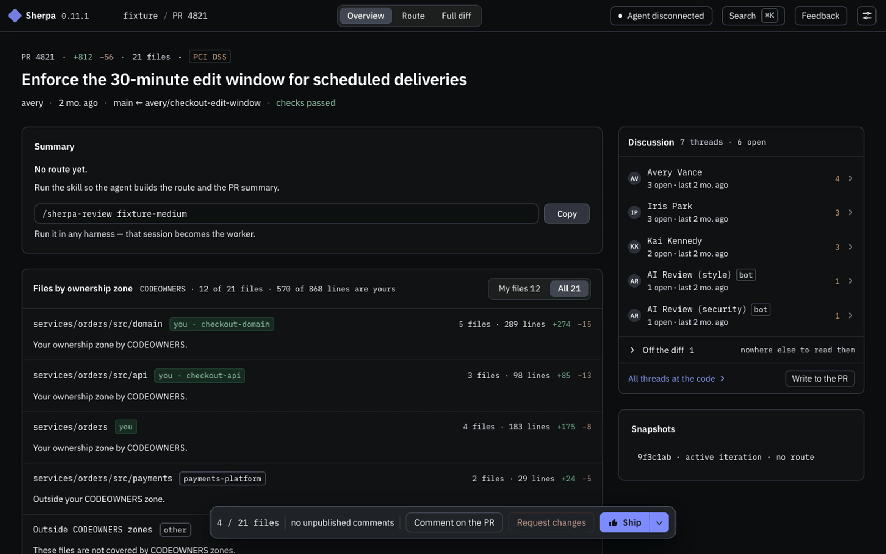
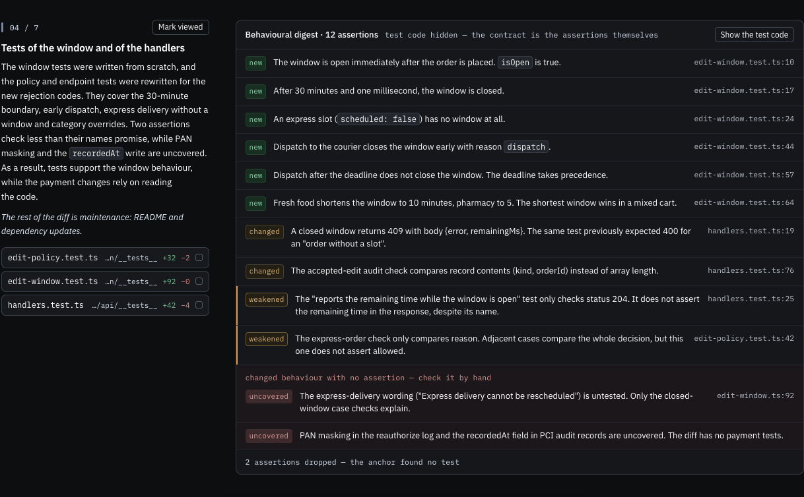
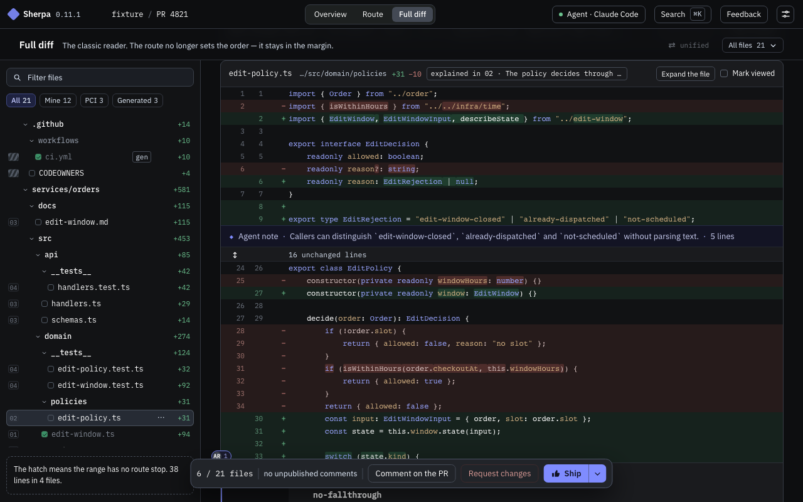

# Sherpa

Sherpa is a tool for AI-assisted code review in the browser. Your own agent, Claude Code or Codex, reads the pull request and builds a **route** through it: stops ordered by importance, each with an explanation beside the real diff. You start with the stops that matter and skim the rest, and nothing disappears along the way. The same agent answers questions right beside the lines you ask about.

The agent explains the change and says where to look first. The verdict stays yours.

[Quick start](#quick-start) · [What you get](#what-you-get) · [User guide](docs/guide.md)



The summary and the route fill in, the reviewer reads the stops, leaves a comment and clicks "Request changes". The recording uses a demo PR with a prepared route, so the agent's thinking time is not in it. Somewhere out there, another agent spends that time opening the next pull request. [High-resolution MP4](docs/assets/review-demo.mp4) · [Still frame](docs/assets/review-demo.png).

What sets Sherpa apart from a review page with an AI summary on top:

- **Importance, not file order.** Stops are ordered by tier, and the low tier starts collapsed, so a one-line config change comes before 40 renamed imports.
- **Nothing disappears.** Every fold shows how many lines are inside. Ranges the agent did not explain are hatched in the diff. A validator, not the prompt, checks that the route covers the whole diff.
- **What the tests actually check.** A stop can show the tests as assertions in plain language, each linked to its test line, and flag the checks that got weaker.
- **No account, no API key, no backend.** The model runs in your Claude Code or Codex session with its permissions, and Sherpa's server runs on your machine.
- **Works without the agent.** The route is a layer on top of a complete review interface. If the agent dies mid-review, you keep reading, commenting and publishing, and the built route stays on screen. New questions and generation resume when an agent reconnects.

Sherpa is for reviewers who get more pull requests than they can read line by line.

## Quick start

You need Node 22.13 or later, an agent harness that supports skills (Claude Code is tested, Codex has had less testing) and, for GitHub PRs, a token from `$GITHUB_TOKEN`, `$GH_TOKEN` or `gh auth token`. The PR is read through the API, so no checkout is needed. [Requirements in detail](docs/operations.md#requirements-in-detail), including the recommended models.

Install the skill with [`skills`](https://skills.sh):

```
npx skills add Nodge/sherpa-review -g
```

`-g` makes the skill available in all projects. Without it, the skill goes into the current project. The installer asks which harnesses to install it for. The skill is a stub that runs `npx -y sherpa-review@latest`, so every new session uses the latest published version and there is nothing to update by hand.

Then, in an agent session, call the skill with a PR link:

```
/sherpa-review https://github.com/quillmart/quillmart/pull/12345
```

The UI opens in your browser, and the agent stays in the session as a worker: it builds the route, answers questions and waits for the next task. **The printed link contains the access token, so do not publish it.**

### Local review

Call the skill with no argument, or with a directory path, and Sherpa reviews everything that changed in that git checkout against the base, committed or not. The default base is the merge-base with `origin/HEAD`, `main` or `master`. Tell the agent if you want a different one.

Local review never becomes a PR review, even if the branch has a PR. When you publish local comments, the agent in the same session receives them as requests to fix the code and replies in the same threads.

## What you get

### The route

Generation starts on its own once the agent connects and the diff loads. Stops appear as the agent produces them, and the UI is usable before the route is complete. Each stop has a title, a paragraph on what changed and what follows from it, and a real diff reader for its lines, so you comment, mark viewed and expand context right there.

"Triage" orders the stops by importance, "Full tour" by reading order: entry point, then definitions, consequences and verification. Ranges the agent did not place go into an "Other" stop, with a button that asks the agent to place them. Small PRs, up to 40 changed lines, get no route and open as a plain diff.

### What the tests actually check

A stop can show a digest of the tests instead of their code: new assertions, changed assertions, weaker checks and behaviour with no test. Each assertion links back to its test line, and "Show the test code" opens the underlying diff.



In this demo PR, a test named "reports the remaining time" checks only status 204. The digest marks it as weakened and points to the assertion.

### Ask the agent

Select lines and choose "Ask the agent". The question goes to the same agent session, and the answer stays beside those lines as a collapsible note. Notes stay in Sherpa until you turn one into a comment draft, which gets the mark "quoted from an agent answer".

### A second pass after the code changes

When the author pushes another commit, or the working tree changes in local review, Sherpa shows a "Route is stale" banner. "Rebuild the route" gives the agent the previous route and the discussion on the affected lines. In local review, Sherpa also keeps the history of iterations: stops on untouched lines stay viewed, and "What is new since the last pass" leaves only the changed content on screen.

### A complete review interface



Overview groups the files by CODEOWNERS zone. Full diff has a file tree, search, unified and split modes, image comparisons and rendered Markdown. Comments are saved as drafts immediately and published as one batch when you approve, request changes or publish without a verdict. The whole review works from the keyboard (`?` shows the map), in English or Russian, light or dark.

The [user guide](docs/guide.md) covers all of this in detail, including the vocabulary Sherpa uses on screen.

## Where it runs and what it sends

The server and the UI run on your machine, and the model runs in your agent harness. Sherpa makes 2 kinds of external requests: to GitHub with your token, for PRs on github.com, and to the npm registry through `npx` when a session starts. The browser also loads profile photos from the URLs GitHub supplies. There is no telemetry. Routes, progress and chat history live in SQLite under `~/.sherpa`, GitHub keeps comment drafts in a pending review, and local review keeps its comments on disk. All of it survives a server restart or a dead agent session. [Configuration, storage and troubleshooting](docs/operations.md).

## Status and limits

Sherpa is in active development, so rough edges happen. One PR per session, one session per PR. Hosts are GitHub and a local git checkout. Sherpa does not generate its own findings. It shows existing comments, including AI review comments.

## Feedback

The Feedback button in the top bar opens [GitHub issues](https://github.com/Nodge/sherpa-review/issues) of this repository in your browser. Sherpa itself sends nothing. Security problems go through [SECURITY.md](SECURITY.md) rather than a public issue.

## Development

Sherpa is a TypeScript pnpm monorepo built with esbuild: one `sherpa-review` command and a server module beside it. [`docs/`](docs/README.md) explains how the system works and why, and [`CONTRIBUTING.md`](CONTRIBUTING.md) covers building, running and testing.

## License

[MIT](LICENSE), copyright (c) 2026 Maksim Zemskov.
